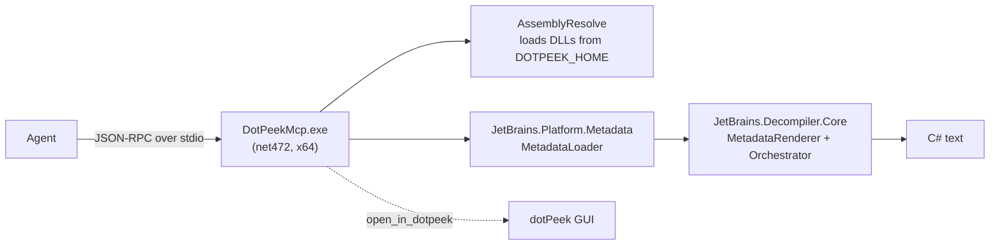

<div align="center">

**English** · [Español](docs/readme/README_es.md) · [Português (Brasil)](docs/readme/README_pt-BR.md) · [简体中文](docs/readme/README_zh.md)

# dotpeek-mcp

### An MCP server that decompiles .NET assemblies with dotPeek's own engine.

**Point your agent at a `.dll` or `.exe`. Get types, members, and the same C# that dotPeek shows, without opening the GUI.**

[](#requirements)
[](#requirements)
[](#requirements)
[](#set-up-your-agent)

[Quick start](#quick-start) · [How it works](#how-it-works) · [Tools](#tools) · [Examples](#examples) · [FAQ](#faq) · [Configuration](#configuration)

</div>

> [!IMPORTANT]
> This is an academic research project. It ships **no JetBrains binaries**: it compiles against your local dotPeek install and loads its DLLs from there at runtime.
> The dotPeek license restricts reverse engineering and derivative works. Use this only if you have the rights to do so.

---

Your agent asks for a type or a method; the server loads the assembly with JetBrains' metadata reader and renders C# with `JetBrains.Decompiler.Core`, through the same pipeline dotPeek uses to display a type. Everything runs locally over stdio. No network, no GUI, no ports.

It is not a dotPeek plugin. dotPeek's standalone host does not install plugins, so the server is its own process that reuses dotPeek's engine headlessly.

## Quick start

### Requirements

- Windows x64 with **dotPeek 2026.2** installed (default: `%LOCALAPPDATA%\JetBrains\Installations\dotPeek262`).
- .NET SDK to build. The binary targets .NET Framework 4.7.2, which ships with Windows.
- Python 3, only for the smoke test.

### Build

```powershell
git clone https://github.com/matiasdante/dotpeek-mcp
cd dotpeek-mcp
dotnet build -c Release
```

If dotPeek lives elsewhere, build with `-p:DotPeekHome=<folder>` and pass `DOTPEEK_HOME=<folder>` at runtime.

### Set up your agent

Claude Code:

```powershell
claude mcp add dotpeek -- "<repo>\bin\Release\net472\DotPeekMcp.exe"
```

Any other MCP client that supports local stdio servers:

```json
{
  "mcpServers": {
    "dotpeek": {
      "command": "<repo>\\bin\\Release\\net472\\DotPeekMcp.exe",
      "env": { "DOTPEEK_MCP_ALLOWED_DIRS": "C:\\work\\assemblies" }
    }
  }
}
```

MCP servers load when a session starts: open a new one and check with `/mcp` that `dotpeek` is connected.

### Ask your agent

```text
Load C:\libs\Newtonsoft.Json.dll, list the types in Newtonsoft.Json.Linq,
and decompile JsonConvert.SerializeObject.
```

## How it works



Before loading, the server reads the assembly's references to pick the right runtime: .NET Framework assemblies resolve against `Framework64\v4.0.30319`, modern ones against the newest `dotnet\shared` runtime. Loaded assemblies stay cached for the life of the process.

## Tools

| Tool               | Arguments                    | Returns                                                            |
| ------------------ | ---------------------------- | ------------------------------------------------------------------ |
| `load_assembly`    | `path`                       | Name, version, target framework, references, type count            |
| `list_types`       | `path`, optional `filter`    | `kind visibility Full.Name`, one per line                          |
| `get_type_members` | `path`, `type`               | Methods, properties, fields, and events with signatures            |
| `decompile_type`   | `path`, `type`               | C# for the whole type                                              |
| `decompile_method` | `path`, `type`, `method`     | C# for every overload with that name (`.ctor` for constructors)    |
| `search_members`   | `path`, `query`              | Types and members whose name contains the text (max 200)           |
| `open_in_dotpeek`  | `path`                       | Opens the assembly in the dotPeek GUI, reusing a running instance  |

Nested types use `+` (`Outer+Inner`). Caller errors (missing file, unknown type or method, path outside the allowlist) come back as tool errors with a hint, not as protocol failures.

## Examples

### Decompile a type

`decompile_type` on the test fixture, `Fixture.Calculator`:

```csharp
#nullable disable
namespace Fixture;

public class Calculator
{
  public int Add(int a, int b) => a + b;

  public string Greet(string name) => "hi " + name;
}
```

### Explore a real library

On `Newtonsoft.Json.dll` (727 types), `list_types` with filter `Linq`, then `decompile_type` on `Newtonsoft.Json.Linq.JObject`, returns about 19 KB of C# in roughly 1.4 s including the load.

### Compare with the GUI

`open_in_dotpeek` opens the same assembly in dotPeek, so you can check the agent's output side by side.

## Configuration

| Variable                   | Default                                              | Use                                                        |
| -------------------------- | ---------------------------------------------------- | ---------------------------------------------------------- |
| `DOTPEEK_HOME`             | `%LOCALAPPDATA%\JetBrains\Installations\dotPeek262`  | dotPeek install folder                                     |
| `DOTPEEK_MCP_ALLOWED_DIRS` | unrestricted                                         | `;`-separated folders; any path outside them is rejected   |
| `DOTPEEK_MCP_MAX_CHARS`    | `60000`                                              | Truncates long responses with a notice                     |

## FAQ

<details>
<summary><strong>Is the output identical to dotPeek's?</strong></summary>

The decompiler and renderer are the same. The GUI adds PSI-based extras this server skips (XML docs, some annotations, parameter names resolved through PDBs), so small details can differ.

</details>

<details>
<summary><strong>Why not a dotPeek plugin?</strong></summary>

dotPeek's plugin installer only works when it is hosted inside Visual Studio; the standalone app reports plugins as unsupported. A separate process avoids patching dotPeek and keeps its install untouched.

</details>

<details>
<summary><strong>Does it run code from the assembly?</strong></summary>

No. Assemblies are read as metadata; nothing is loaded into the CLR for execution. To confine which files the agent can read, set `DOTPEEK_MCP_ALLOWED_DIRS`.

</details>

<details>
<summary><strong>Will a dotPeek update break it?</strong></summary>

Possibly. It uses internal JetBrains APIs pinned to 2026.2.4. A major update may need a rebuild or code changes; run the smoke test after updating.

</details>

## Verification

```powershell
python tests/smoke_test.py
```

Builds the server and a .NET 8 fixture, then drives every read-only tool against the fixture and against `DotPeekMcp.exe` itself (.NET Framework). It also covers error paths (missing type, missing file) and the path allowlist. Expected output: `smoke test OK` followed by the decompiled `Calculator`.

## Known limits

- Windows only, and dotPeek must be installed.
- No XML docs or PSI resolution.
- Loaded assemblies stay in memory while the process lives.
