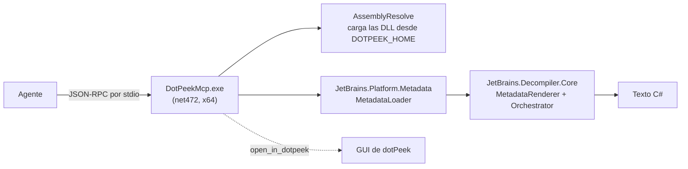

<div align="center">

[English](../../README.md) · **Español** · [Português (Brasil)](README_pt-BR.md) · [简体中文](README_zh.md)

# dotpeek-mcp

### Un servidor MCP que descompila assemblies .NET con el motor propio de dotPeek.

**Apuntá tu agente a un `.dll` o `.exe`. Obtené tipos, miembros y el mismo C# que muestra dotPeek, sin abrir la GUI.**

[](#requisitos)
[](#requisitos)
[](#requisitos)
[](#configurá-tu-agente)

[Inicio rápido](#inicio-rápido) · [Cómo funciona](#cómo-funciona) · [Tools](#tools) · [Ejemplos](#ejemplos) · [Preguntas frecuentes](#preguntas-frecuentes) · [Configuración](#configuración)

</div>

> [!IMPORTANT]
> Este es un proyecto de investigación académica. **No incluye binarios de JetBrains**: compila contra tu instalación local de dotPeek y carga sus DLL desde ahí en tiempo de ejecución.
> La licencia de dotPeek restringe la ingeniería inversa y las obras derivadas. Usalo solo si tenés los derechos para hacerlo.

---

Tu agente pide un tipo o un método; el servidor carga el assembly con el lector de metadata de JetBrains y genera C# con `JetBrains.Decompiler.Core`, por el mismo pipeline que usa dotPeek para mostrar un tipo. Todo corre local por stdio. Sin red, sin GUI, sin puertos.

No es un plugin de dotPeek. El host standalone de dotPeek no instala plugins, así que el servidor es un proceso propio que reutiliza el motor de dotPeek sin interfaz.

## Inicio rápido

### Requisitos

- Windows x64 con **dotPeek 2026.2** instalado (por defecto: `%LOCALAPPDATA%\JetBrains\Installations\dotPeek262`).
- .NET SDK para compilar. El binario apunta a .NET Framework 4.7.2, que viene con Windows.
- Python 3, solo para el smoke test.

### Compilar

```powershell
git clone https://github.com/matiasdante/dotpeek-mcp
cd dotpeek-mcp
dotnet build -c Release
```

Si dotPeek está en otra carpeta, compilá con `-p:DotPeekHome=<carpeta>` y pasá `DOTPEEK_HOME=<carpeta>` en tiempo de ejecución.

### Configurá tu agente

Claude Code:

```powershell
claude mcp add dotpeek -- "<repo>\bin\Release\net472\DotPeekMcp.exe"
```

Cualquier otro cliente MCP que soporte servidores stdio locales:

```json
{
  "mcpServers": {
    "dotpeek": {
      "command": "<repo>\\bin\\Release\\net472\\DotPeekMcp.exe",
      "env": { "DOTPEEK_MCP_ALLOWED_DIRS": "C:\\work\\assemblies" }
    }
  }
}
```

Los servidores MCP se cargan al iniciar la sesión: abrí una nueva y verificá con `/mcp` que `dotpeek` esté conectado.

### Pedile a tu agente

```text
Cargá C:\libs\Newtonsoft.Json.dll, listá los tipos de Newtonsoft.Json.Linq
y descompilá JsonConvert.SerializeObject.
```

## Cómo funciona



Antes de cargar, el servidor lee las referencias del assembly para elegir el runtime correcto: los assemblies de .NET Framework se resuelven contra `Framework64\v4.0.30319` y los modernos contra el runtime más nuevo de `dotnet\shared`. Los assemblies cargados quedan en caché mientras vive el proceso.

## Tools

| Tool               | Argumentos                   | Devuelve                                                          |
| ------------------ | ---------------------------- | ----------------------------------------------------------------- |
| `load_assembly`    | `path`                       | Nombre, versión, target framework, referencias, cantidad de tipos |
| `list_types`       | `path`, `filter` opcional    | `kind visibilidad Nombre.Completo`, uno por línea                 |
| `get_type_members` | `path`, `type`               | Métodos, propiedades, campos y eventos con firma                  |
| `decompile_type`   | `path`, `type`               | C# del tipo completo                                              |
| `decompile_method` | `path`, `type`, `method`     | C# de todas las sobrecargas con ese nombre (`.ctor` para constructores) |
| `search_members`   | `path`, `query`              | Tipos y miembros cuyo nombre contiene el texto (máx. 200)         |
| `open_in_dotpeek`  | `path`                       | Abre el assembly en la GUI de dotPeek, reusando la instancia abierta |

Los tipos anidados usan `+` (`Externo+Interno`). Los errores del llamador (archivo inexistente, tipo o método desconocido, ruta fuera de la lista permitida) vuelven como errores de tool con una pista, no como fallas del protocolo.

## Ejemplos

### Descompilar un tipo

`decompile_type` sobre el fixture de prueba, `Fixture.Calculator`:

```csharp
#nullable disable
namespace Fixture;

public class Calculator
{
  public int Add(int a, int b) => a + b;

  public string Greet(string name) => "hi " + name;
}
```

### Explorar una librería real

Sobre `Newtonsoft.Json.dll` (727 tipos), `list_types` con filtro `Linq` y después `decompile_type` sobre `Newtonsoft.Json.Linq.JObject` devuelve unos 19 KB de C# en aproximadamente 1,4 s, carga incluida.

### Comparar con la GUI

`open_in_dotpeek` abre el mismo assembly en dotPeek para revisar la salida del agente lado a lado.

## Configuración

| Variable                   | Default                                              | Uso                                                        |
| -------------------------- | ---------------------------------------------------- | ---------------------------------------------------------- |
| `DOTPEEK_HOME`             | `%LOCALAPPDATA%\JetBrains\Installations\dotPeek262`  | Carpeta de instalación de dotPeek                          |
| `DOTPEEK_MCP_ALLOWED_DIRS` | sin límite                                           | Carpetas separadas por `;`; cualquier ruta fuera se rechaza |
| `DOTPEEK_MCP_MAX_CHARS`    | `60000`                                              | Corta las respuestas largas con un aviso                   |

## Preguntas frecuentes

<details>
<summary><strong>¿La salida es idéntica a la de dotPeek?</strong></summary>

El descompilador y el renderer son los mismos. La GUI suma extras basados en PSI que este servidor omite (XML docs, algunas anotaciones, nombres de parámetros resueltos vía PDB), así que pueden diferir detalles menores.

</details>

<details>
<summary><strong>¿Por qué no un plugin de dotPeek?</strong></summary>

El instalador de plugins de dotPeek solo funciona cuando corre dentro de Visual Studio; la app standalone informa que los plugins no están soportados. Un proceso aparte evita parchear dotPeek y deja su instalación intacta.

</details>

<details>
<summary><strong>¿Ejecuta código del assembly?</strong></summary>

No. Los assemblies se leen como metadata; nada se carga en el CLR para ejecutarse. Para limitar qué archivos puede leer el agente, configurá `DOTPEEK_MCP_ALLOWED_DIRS`.

</details>

<details>
<summary><strong>¿Una actualización de dotPeek lo rompe?</strong></summary>

Puede ser. Usa APIs internas de JetBrains fijadas a 2026.2.4. Una actualización mayor puede requerir recompilar o cambiar código; corré el smoke test después de actualizar.

</details>

## Verificación

```powershell
python tests/smoke_test.py
```

Compila el servidor y un fixture .NET 8, y recorre todas las tools de lectura sobre el fixture y sobre el propio `DotPeekMcp.exe` (.NET Framework). También cubre los caminos de error (tipo y archivo inexistentes) y la lista de rutas permitidas. Salida esperada: `smoke test OK` seguido de `Calculator` descompilado.

## Límites conocidos

- Solo Windows, y requiere dotPeek instalado.
- Sin XML docs ni resolución vía PSI.
- Los assemblies cargados quedan en memoria mientras vive el proceso.
