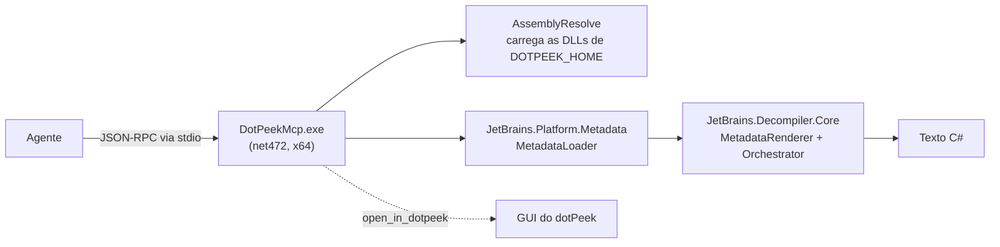

<div align="center">

[English](../../README.md) · [Español](README_es.md) · **Português (Brasil)** · [简体中文](README_zh.md)

# dotpeek-mcp

### Um servidor MCP que descompila assemblies .NET com o próprio motor do dotPeek.

**Aponte seu agente para um `.dll` ou `.exe`. Receba tipos, membros e o mesmo C# que o dotPeek mostra, sem abrir a GUI.**

[](#requisitos)
[](#requisitos)
[](#requisitos)
[](#configure-seu-agente)

[Início rápido](#início-rápido) · [Como funciona](#como-funciona) · [Tools](#tools) · [Exemplos](#exemplos) · [Perguntas frequentes](#perguntas-frequentes) · [Configuração](#configuração)

</div>

> [!IMPORTANT]
> Este é um projeto de pesquisa acadêmica. Ele **não inclui binários da JetBrains**: compila contra a sua instalação local do dotPeek e carrega as DLLs de lá em tempo de execução.
> A licença do dotPeek restringe engenharia reversa e obras derivadas. Use somente se você tiver os direitos para isso.

---

Seu agente pede um tipo ou um método; o servidor carrega o assembly com o leitor de metadados da JetBrains e gera C# com `JetBrains.Decompiler.Core`, pelo mesmo pipeline que o dotPeek usa para exibir um tipo. Tudo roda localmente via stdio. Sem rede, sem GUI, sem portas.

Não é um plugin do dotPeek. O host standalone do dotPeek não instala plugins, então o servidor é um processo próprio que reutiliza o motor do dotPeek sem interface.

## Início rápido

### Requisitos

- Windows x64 com **dotPeek 2026.2** instalado (padrão: `%LOCALAPPDATA%\JetBrains\Installations\dotPeek262`).
- .NET SDK para compilar. O binário usa o .NET Framework 4.7.2, que já vem com o Windows.
- Python 3, apenas para o smoke test.

### Compilar

```powershell
git clone https://github.com/matiasdante/dotpeek-mcp
cd dotpeek-mcp
dotnet build -c Release
```

Se o dotPeek estiver em outra pasta, compile com `-p:DotPeekHome=<pasta>` e defina `DOTPEEK_HOME=<pasta>` em tempo de execução.

### Configure seu agente

Claude Code:

```powershell
claude mcp add dotpeek -- "<repo>\bin\Release\net472\DotPeekMcp.exe"
```

Qualquer outro cliente MCP que suporte servidores stdio locais:

```json
{
  "mcpServers": {
    "dotpeek": {
      "command": "<repo>\\bin\\Release\\net472\\DotPeekMcp.exe",
      "env": { "DOTPEEK_MCP_ALLOWED_DIRS": "C:\\work\\assemblies" }
    }
  }
}
```

Os servidores MCP são carregados no início da sessão: abra uma nova e confirme com `/mcp` que `dotpeek` está conectado.

### Peça ao seu agente

```text
Carregue C:\libs\Newtonsoft.Json.dll, liste os tipos de Newtonsoft.Json.Linq
e descompile JsonConvert.SerializeObject.
```

## Como funciona



Antes de carregar, o servidor lê as referências do assembly para escolher o runtime certo: assemblies do .NET Framework são resolvidos contra `Framework64\v4.0.30319`, e os modernos contra o runtime mais recente de `dotnet\shared`. Os assemblies carregados ficam em cache enquanto o processo estiver ativo.

## Tools

| Tool               | Argumentos                   | Retorna                                                            |
| ------------------ | ---------------------------- | ------------------------------------------------------------------ |
| `load_assembly`    | `path`                       | Nome, versão, target framework, referências, quantidade de tipos   |
| `list_types`       | `path`, `filter` opcional    | `kind visibilidade Nome.Completo`, um por linha                    |
| `get_type_members` | `path`, `type`               | Métodos, propriedades, campos e eventos com assinatura             |
| `decompile_type`   | `path`, `type`               | C# do tipo inteiro                                                 |
| `decompile_method` | `path`, `type`, `method`     | C# de todas as sobrecargas com esse nome (`.ctor` para construtores) |
| `search_members`   | `path`, `query`              | Tipos e membros cujo nome contém o texto (máx. 200)                |
| `open_in_dotpeek`  | `path`                       | Abre o assembly na GUI do dotPeek, reutilizando a instância aberta |

Tipos aninhados usam `+` (`Externo+Interno`). Erros de quem chama (arquivo inexistente, tipo ou método desconhecido, caminho fora da lista permitida) voltam como erros de tool com uma dica, não como falhas de protocolo.

## Exemplos

### Descompilar um tipo

`decompile_type` no fixture de teste, `Fixture.Calculator`:

```csharp
#nullable disable
namespace Fixture;

public class Calculator
{
  public int Add(int a, int b) => a + b;

  public string Greet(string name) => "hi " + name;
}
```

### Explorar uma biblioteca real

Em `Newtonsoft.Json.dll` (727 tipos), `list_types` com filtro `Linq` e depois `decompile_type` em `Newtonsoft.Json.Linq.JObject` retorna cerca de 19 KB de C# em aproximadamente 1,4 s, incluindo o carregamento.

### Comparar com a GUI

`open_in_dotpeek` abre o mesmo assembly no dotPeek para você conferir a saída do agente lado a lado.

## Configuração

| Variável                   | Padrão                                               | Uso                                                         |
| -------------------------- | ---------------------------------------------------- | ----------------------------------------------------------- |
| `DOTPEEK_HOME`             | `%LOCALAPPDATA%\JetBrains\Installations\dotPeek262`  | Pasta de instalação do dotPeek                              |
| `DOTPEEK_MCP_ALLOWED_DIRS` | sem restrição                                        | Pastas separadas por `;`; qualquer caminho fora é rejeitado |
| `DOTPEEK_MCP_MAX_CHARS`    | `60000`                                              | Corta respostas longas com um aviso                         |

## Perguntas frequentes

<details>
<summary><strong>A saída é idêntica à do dotPeek?</strong></summary>

O descompilador e o renderer são os mesmos. A GUI adiciona extras baseados em PSI que este servidor ignora (XML docs, algumas anotações, nomes de parâmetros resolvidos via PDB), então pequenos detalhes podem mudar.

</details>

<details>
<summary><strong>Por que não um plugin do dotPeek?</strong></summary>

O instalador de plugins do dotPeek só funciona quando ele roda dentro do Visual Studio; o app standalone informa que plugins não são suportados. Um processo separado evita modificar o dotPeek e mantém a instalação intacta.

</details>

<details>
<summary><strong>Ele executa código do assembly?</strong></summary>

Não. Os assemblies são lidos como metadados; nada é carregado no CLR para execução. Para limitar quais arquivos o agente pode ler, defina `DOTPEEK_MCP_ALLOWED_DIRS`.

</details>

<details>
<summary><strong>Uma atualização do dotPeek pode quebrá-lo?</strong></summary>

Pode. Ele usa APIs internas da JetBrains fixadas na versão 2026.2.4. Uma atualização maior pode exigir recompilar ou alterar o código; rode o smoke test depois de atualizar.

</details>

## Verificação

```powershell
python tests/smoke_test.py
```

Compila o servidor e um fixture .NET 8 e executa todas as tools de leitura no fixture e no próprio `DotPeekMcp.exe` (.NET Framework). Também cobre os caminhos de erro (tipo e arquivo inexistentes) e a lista de caminhos permitidos. Saída esperada: `smoke test OK` seguido de `Calculator` descompilado.

## Limites conhecidos

- Somente Windows, e exige o dotPeek instalado.
- Sem XML docs nem resolução via PSI.
- Os assemblies carregados ficam em memória enquanto o processo estiver ativo.
