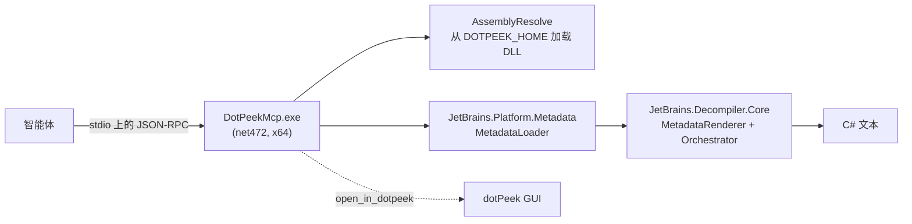

<div align="center">

[English](../../README.md) · [Español](README_es.md) · [Português (Brasil)](README_pt-BR.md) · **简体中文**

# dotpeek-mcp

### 使用 dotPeek 自身引擎反编译 .NET 程序集的 MCP 服务器。

**把智能体指向一个 `.dll` 或 `.exe`，即可获得类型、成员以及与 dotPeek 显示一致的 C# 代码，无需打开 GUI。**

[](#环境要求)
[](#环境要求)
[](#环境要求)
[](#配置智能体)

[快速开始](#快速开始) · [工作原理](#工作原理) · [工具](#工具) · [示例](#示例) · [常见问题](#常见问题) · [配置](#配置)

</div>

> [!IMPORTANT]
> 这是一个学术研究项目。它**不包含任何 JetBrains 二进制文件**：编译时引用本机已安装的 dotPeek，运行时也从该目录加载其 DLL。
> dotPeek 的许可协议限制逆向工程和衍生作品。请仅在你拥有相应权利时使用。

---

智能体请求某个类型或方法时，服务器使用 JetBrains 的元数据读取器加载程序集，并通过 `JetBrains.Decompiler.Core` 生成 C#，走的是 dotPeek 显示类型时所用的同一条管线。一切都通过 stdio 在本地运行：不联网、无 GUI、不监听端口。

它不是 dotPeek 插件。dotPeek 的独立宿主不支持安装插件，因此服务器是一个独立进程，以无界面方式复用 dotPeek 的引擎。

## 快速开始

### 环境要求

- Windows x64，并已安装 **dotPeek 2026.2**（默认路径：`%LOCALAPPDATA%\JetBrains\Installations\dotPeek262`）。
- 编译需要 .NET SDK。二进制文件面向 .NET Framework 4.7.2，Windows 已自带。
- Python 3，仅用于冒烟测试。

### 编译

```powershell
git clone https://github.com/matiasdante/dotpeek-mcp
cd dotpeek-mcp
dotnet build -c Release
```

如果 dotPeek 安装在其他目录，编译时加上 `-p:DotPeekHome=<目录>`，运行时设置 `DOTPEEK_HOME=<目录>`。

### 配置智能体

Claude Code：

```powershell
claude mcp add dotpeek -- "<repo>\bin\Release\net472\DotPeekMcp.exe"
```

其他支持本地 stdio 服务器的 MCP 客户端：

```json
{
  "mcpServers": {
    "dotpeek": {
      "command": "<repo>\\bin\\Release\\net472\\DotPeekMcp.exe",
      "env": { "DOTPEEK_MCP_ALLOWED_DIRS": "C:\\work\\assemblies" }
    }
  }
}
```

MCP 服务器在会话启动时加载：请新开一个会话，并用 `/mcp` 确认 `dotpeek` 已连接。

### 向智能体提问

```text
加载 C:\libs\Newtonsoft.Json.dll，列出 Newtonsoft.Json.Linq 中的类型，
并反编译 JsonConvert.SerializeObject。
```

## 工作原理



加载前，服务器会先读取程序集的引用以选择正确的运行时：.NET Framework 程序集解析到 `Framework64\v4.0.30319`，现代程序集解析到 `dotnet\shared` 中最新的运行时。已加载的程序集在进程存活期间一直缓存。

## 工具

| 工具               | 参数                         | 返回                                                    |
| ------------------ | ---------------------------- | ------------------------------------------------------- |
| `load_assembly`    | `path`                       | 名称、版本、目标框架、引用、类型数量                    |
| `list_types`       | `path`，可选 `filter`        | 每行一个 `kind 可见性 完整.名称`                        |
| `get_type_members` | `path`、`type`               | 带签名的方法、属性、字段和事件                          |
| `decompile_type`   | `path`、`type`               | 整个类型的 C#                                           |
| `decompile_method` | `path`、`type`、`method`     | 该名称所有重载的 C#（构造函数用 `.ctor`）               |
| `search_members`   | `path`、`query`              | 名称包含该文本的类型和成员（最多 200 条）               |
| `open_in_dotpeek`  | `path`                       | 在 dotPeek GUI 中打开程序集，复用已运行的实例           |

嵌套类型使用 `+`（`Outer+Inner`）。调用方错误（文件不存在、类型或方法未知、路径不在允许列表内）会作为带提示的工具错误返回，而不是协议错误。

## 示例

### 反编译一个类型

对测试夹具 `Fixture.Calculator` 调用 `decompile_type`：

```csharp
#nullable disable
namespace Fixture;

public class Calculator
{
  public int Add(int a, int b) => a + b;

  public string Greet(string name) => "hi " + name;
}
```

### 浏览真实的库

对 `Newtonsoft.Json.dll`（727 个类型）先用过滤条件 `Linq` 调用 `list_types`，再对 `Newtonsoft.Json.Linq.JObject` 调用 `decompile_type`，约 1.4 秒（含加载）返回约 19 KB 的 C#。

### 与 GUI 对照

`open_in_dotpeek` 会在 dotPeek 中打开同一个程序集，方便与智能体的输出并排比对。

## 配置

| 变量                       | 默认值                                               | 用途                                       |
| -------------------------- | ---------------------------------------------------- | ------------------------------------------ |
| `DOTPEEK_HOME`             | `%LOCALAPPDATA%\JetBrains\Installations\dotPeek262`  | dotPeek 安装目录                           |
| `DOTPEEK_MCP_ALLOWED_DIRS` | 不限制                                               | 以 `;` 分隔的目录；不在其中的路径一律拒绝  |
| `DOTPEEK_MCP_MAX_CHARS`    | `60000`                                              | 截断过长的响应并附上提示                   |

## 常见问题

<details>
<summary><strong>输出与 dotPeek 完全一致吗？</strong></summary>

反编译器和渲染器是同一套。GUI 还会加入一些基于 PSI 的额外信息（XML 文档、部分注解、通过 PDB 解析的参数名），本服务器不包含这些，因此细节可能略有差异。

</details>

<details>
<summary><strong>为什么不做成 dotPeek 插件？</strong></summary>

dotPeek 的插件安装器只有在其运行于 Visual Studio 内部时才可用；独立版应用会报告不支持插件。使用独立进程无需修改 dotPeek，也不会改动其安装目录。

</details>

<details>
<summary><strong>它会执行程序集中的代码吗？</strong></summary>

不会。程序集只作为元数据读取，不会加载到 CLR 中执行。如需限制智能体可读取的文件，请设置 `DOTPEEK_MCP_ALLOWED_DIRS`。

</details>

<details>
<summary><strong>dotPeek 更新后会失效吗？</strong></summary>

有可能。它使用的 JetBrains 内部 API 固定在 2026.2.4 版本。大版本更新可能需要重新编译或修改代码；更新后请运行冒烟测试。

</details>

## 验证

```powershell
python tests/smoke_test.py
```

编译服务器和一个 .NET 8 测试夹具，然后对夹具和 `DotPeekMcp.exe` 本身（.NET Framework）调用所有只读工具。同时覆盖错误路径（类型和文件不存在）以及路径允许列表。预期输出：`smoke test OK`，随后是反编译出的 `Calculator`。

## 已知限制

- 仅支持 Windows，且必须安装 dotPeek。
- 不包含 XML 文档和 PSI 解析。
- 已加载的程序集在进程存活期间常驻内存。
